<div align="center">



<br />


<p>
  <a href="#-cara-ambil--instalasi"></a>&nbsp;&nbsp;
  <a href="#-fitur-utama"></a>&nbsp;&nbsp;
  <a href="#-tim-kontributor"></a>&nbsp;&nbsp;
  <a href="#-alur-kerja--struktur-modul"></a>
</p>



</div>

---

<div align="center">

<h2 id="-tim-kontributor">👥 Tim Kontributor</h2>



</div>

| Nama Kontributor | Peran Utama | Fokus Kontribusi |
|---|---|---|
| **Ananda Gita April Yanto** (`@lelekrecing`) | Lead Full-Stack Developer | Arsitektur Laravel, Pusat Monitoring, Kajian Kelayakan Proyek (KKO/KKF), Simulasi & Kuota Kontrak, Engine Export PDF & Excel (`.xlsx`), UI/UX & Animasi |
| **Rihhadatul Aliyah** | Co-Contributor & Perencanaan | Perumusan alur bisnis UP3 Jambi (ULP & Perencanaan), standar data KHS/Konstruksi SUTM, formulasi kajian kelayakan KKO-KKF & validasi operasional |

> 💡 **Ingin ikut berkontribusi?** Fork repository ini, buat branch baru (`git checkout -b fitur/nama-fitur`), commit perubahan Anda, lalu ajukan **Pull Request**.

---

<div align="center">

<h2 id="-tech-stack">⚙️ Tech Stack</h2>



</div>

- **Backend**: PHP `^8.3`, Laravel Framework `^13.8`, `maatwebsite/excel` (`3.1.69` / `PhpSpreadsheet`), generator PDF native PHP (`Pure-PHP PDF` tanpa dependensi eksternal berat)
- **Frontend**: Blade Templates, Tailwind CSS `^4.0.0`, Vite `^8.0.0`, Vanilla JavaScript
- **Database**: MySQL / MariaDB (kompatibel penuh dengan Laragon / XAMPP)

---

<h2 id="-fitur-utama">⚡ Fitur Utama</h2>

| Modul | Deskripsi & Kemampuan | Akses |
|---|---|---|
| **Dashboard Utama Perencanaan** | Ringkasan analitik proyek, **Grafik Sisa Kuota Vendor (%)**, **Grafik Progress per Vendor**, pencarian sheet global, dan filter tahun tanpa menghilangkan menu sidebar utama | User / ULP & Perencanaan |
| **Pusat Monitoring (`KHS`, `Tiang`, `Pelanggan`)** | Tampilan multi-sheet dinamis dengan live search, filter tahun, pilihan tampil **10 / 25 / 50 / 100** baris per halaman, dan **Cetak PDF** langsung per sheet (`/sheet/{id}/export-pdf`) | User & Admin |
| **Standar Konstruksi SUTM** | Katalog gambar & detail teknis konstruksi jaringan, import Excel oleh admin, filter tampilan **10 / 25 / 50 / 100**, serta **Cetak PDF** (`/standar-konstruksi/export-pdf`) | User (Read-Only) & Admin (CRUD/Import) |
| **Kajian Kelayakan Proyek (KKO / KKF)** | Input permohonan baru & pembangunan jaringan dari ULP/Perencanaan, perhitungan **kelayakan finansial & teknis (KKO/KKF)**, manajemen **Kuota Kontrak Vendor** (blokir otomatis saat kuota habis), filter **10 / 25 / 50 / 100**, serta **Export PDF & Excel (`.xlsx`)** baik rekap maupun per dokumen | User / ULP & Perencanaan |
| **Simulasi Cepat KKO-KKF** | Simulasi cepat kebutuhan trafo/jaringan saat diskusi awal (kelayakan proyek sebelum diajukan menjadi kontrak resmi) | User / ULP & Perencanaan |
| **Panel Admin & Riwayat Upload** | Import Excel monitoring (`KHS`, `Tiang`, `Pelanggan`), manajemen riwayat & aktivasi versi upload, serta manajemen akun & reset password anggota | Admin (`AdminSession`) |

---

<h2 id="-cara-ambil--instalasi">📦 Cara Ambil & Instalasi</h2>

### 1. Cara Mengambil Source Code Repository

**Opsi A — Clone menggunakan Git (Direkomendasikan)**
```bash
git clone https://github.com/lelekrecing/monitoring_pln.git
cd monitoring_pln
```

**Opsi B — Download Manual (ZIP)**
1. Buka halaman repository: [github.com/lelekrecing/monitoring_pln](https://github.com/lelekrecing/monitoring_pln)
2. Klik tombol hijau **`<> Code`** lalu pilih **`Download ZIP`**
3. Ekstrak folder ke direktori web server lokal Anda (misalnya `C:\laragon\www\monitoring-pln` atau `D:\laragon\www\monitoring-pln`)

---

### 2. Prasyarat Sistem
Pastikan perangkat Anda sudah terpasang:
- **PHP `>= 8.3`** (ekstensi `zip`, `gd`, `mbstring`, `pdo_mysql`, `xml` aktif)
- **Composer**
- **Node.js & NPM**
- **MySQL / MariaDB** (misalnya melalui Laragon atau XAMPP)

---

### 3. Langkah Instalasi & Menjalankan Lokal

```bash
# 1. Install dependensi PHP (Laravel, Maatwebsite Excel, dll)
composer install

# 2. Install dependensi Frontend (Vite 8 & Tailwind CSS 4)
npm install

# 3. Salin file environment dan buat application key
cp .env.example .env
php artisan key:generate
```

Buka file `.env` dan sesuaikan konfigurasi database MySQL Anda:
```env
DB_CONNECTION=mysql
DB_HOST=127.0.0.1
DB_PORT=3306
DB_DATABASE=monitoring_pln
DB_USERNAME=root
DB_PASSWORD=
```

Lanjutkan dengan migrasi database & build aset:
```bash
# 4. Buat database 'monitoring_pln' di MySQL/phpMyAdmin, lalu jalankan migrasi
php artisan migrate

# 5. Build aset frontend untuk production
npm run build

# 6. Jalankan server lokal Laravel
php artisan serve
```

Aplikasi dapat diakses melalui browser di:
- **Halaman User / ULP**: `http://127.0.0.1:8000` (`/login`, `/dashboard`)
- **Halaman Admin**: `http://127.0.0.1:8000/admin` (`/dashboard-admin`)

*(Tips: Untuk mode pengembangan sekaligus menjalankan server + Vite watcher, Anda juga bisa menjalankan `composer run dev`.)*

---

### 4. Cara Mengambil Update & Mengirim Perubahan (Git Workflow)

**Mengambil pembaruan terbaru dari GitHub:**
```bash
git pull origin main
composer install
npm install && npm run build
php artisan migrate
```

**Menyimpan & mengirim perubahan ke repository GitHub:**
```bash
git add .
git commit -m "deskripsi perubahan Anda"
git push origin main
```

---

<h2 id="-alur-kerja--struktur-modul">🛠️ Alur Kerja & Struktur Modul</h2>

1. **Admin Upload Data (`/upload-excel` & `/admin/standar-konstruksi`)**
   Admin mengunggah file Excel Monitoring (`KHS`, `Tiang`, `Pelanggan`) serta katalog `Standar Konstruksi SUTM` dan mengatur riwayat upload aktif.
2. **Monitoring & Pencarian Terpusat (`/dashboard` & `/sheet/{id}`)**
   User Perencanaan / ULP memantau sisa kuota dan progres tiap vendor, mencari data lintas sheet, mengatur tampilan `10/25/50/100` baris, atau mencetak laporan ke PDF.
3. **Simulasi & Kajian Kelayakan Proyek (`/kajian-kelayakan`)**
   ULP atau Perencanaan melakukan simulasi cepat atau mengajukan kajian kelayakan KKO-KKF. Sistem otomatis menghitung kelayakan serta memvalidasi ketersediaan **Kuota Kontrak Vendor** sebelum dokumen dicetak ke **PDF** atau diunduh dalam format **Excel (`.xlsx`)**.

<details>
<summary><b>📂 Daftar Route Utama Aplikasi (Klik untuk memperluas)</b></summary>

| Area | Route | Fungsi |
|---|---|---|
| Auth User | `GET /`, `GET /login`, `POST /login`, `GET /logout`, `GET /registrasi` | Autentikasi & registrasi akun user |
| Auth Admin | `GET /admin`, `POST /admin/login`, `GET /logout-admin` | Autentikasi khusus admin |
| Monitoring | `GET /dashboard`, `GET /sheet/{id}`, `GET /sheet/{id}/export-pdf`, `GET /search-sheet` | Dashboard user, detail sheet monitoring, live search & export PDF |
| Standar Konstruksi | `GET /standar-konstruksi`, `GET /standar-konstruksi/export-pdf` | Katalog standar konstruksi SUTM & export PDF |
| Kajian Kelayakan | `GET /kajian-kelayakan`, `POST /kajian-kelayakan/simulate`, `POST /kajian-kelayakan/store` | Halaman KKO/KKF, simulasi cepat, dan simpan kajian |
| Export & Kuota KKO/KKF | `GET /kajian-kelayakan/export-pdf`, `GET /kajian-kelayakan/export-excel`, `POST /kajian-kelayakan/kuota` | Export rekap/detail PDF & `.xlsx` serta kontrol kuota vendor |
| Admin Panel | `GET /dashboard-admin`, `GET /upload-excel`, `GET /riwayat-upload`, `GET /admin/anggota` | Upload data Excel, aktivasi riwayat upload, dan manajemen akun |

</details>

---

<div align="center">


</div>
